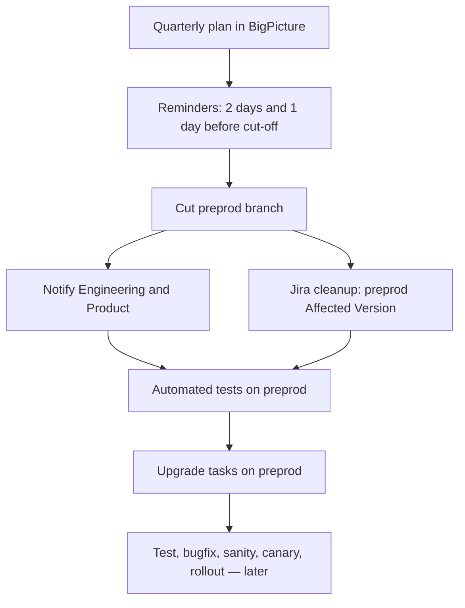

# BigPicture Release Process

**Audience:** QA, Engineering (Cloud and DC), Product Management, Infrastructure, Technical Writing  
**Status:** draft — pending persona review  
**Last updated:** 2026-10-16 (kickoff sequence)  
**Source of technical steps:** [PPM Release Checklist](https://appfire.atlassian.net/wiki/spaces/PROC/pages/277840434/PPM+Release+Checklist) (v36, 2026-03-30)  
**Confluence (after approval):** not created yet

How a BigPicture version moves from branch cut to production. One page.
Job names, Cloud Manager clicks, and filter JQL live in the Cloud and DC
technical documents.

## How to read this page

| Label | Meaning |
|-------|---------|
| **Draft** | Defined here, pending persona review. |
| **Agreed** | Reviewed and accepted by the necessary personas. In force. |
| **Open** | Needs a decision before it is treated as process. |
| **TBD** | Fact, owner, or link missing. |

Do not infer policy from the old checklist. **Everything remains Draft until review.**

---

## 1. Purpose

The PPM Release Checklist is a **technical runbook**. It was written when a
single QA/Release function ran most of the path. That model ended with:

- the **Cloud / DC split**, and
- the **QA/Release re-organisation at the end of August 2026**.

Engineering is taking **some** of the release-process work that used to sit
with QA. This page describes the **process** (phases, gates, who is in the
room). How-tos stay in:

- [Cloud technical](technical/cloud.md) — Jira Cloud, canary, Monday
- [DC technical](technical/dc.md) — Data Center jars and Marketplace

After this markdown is reviewed by the personas below, a short Confluence page
will be published with the graph in section 4.

Related (also Draft): [BP QA–Development Cooperation](../BP%20QA/qa-dev-cooperation.md)
— epic-level QAaaS; Legion and release testing sit **here**, not on an epic path.

---

## 2. Personas who must review this draft

| Persona | Why they review | Status |
|---------|-----------------|--------|
| BigPicture QA | Release testing, Legion, recommendation on quality | Not reviewed |
| Engineering — Cloud | Taking on part of the former QA/Release work on Cloud | Not reviewed |
| Engineering — DC | DC cadence, jars, Marketplace; separate ownership | Not reviewed |
| Product Management | Scope, known issues, **go/no-go** | Not reviewed |
| Infrastructure (PPM / Cloud) | Canary servers, tenant migration, production cutover | Not reviewed |
| Technical Writing | Release notes and Marketplace copy | Not reviewed |

Add missing personas here rather than assuming they are in the loop.

---

## 3. Cadence

**Status: Draft.** Planned at the **start of each quarter** and represented in
BigPicture ([Release Roadmap](https://jira.softwareplant.com/plugins/servlet/softwareplant-bigpicture/#/box/PROG-571/g)).
The [PPM Release Checklist](https://appfire.atlassian.net/wiki/spaces/PROC/pages/277840434/PPM+Release+Checklist)
is the technical companion. The quarterly plan always includes windows for:

| Window | What it covers |
|--------|----------------|
| Branch cut-off | Date the preprod branch is cut |
| Test the cut-off branch | Automated and manual testing |
| Bug-fixing | Time to clear release blockers |
| Sanity and canary | Sanity testing plus canary |
| Full production rollout | Remaining production release |

Hotfix remains an exception path, not a quarterly window.

---

## 4. Process graph

This graph is the intended Confluence figure. Later boxes will be expanded
as the rest of the process is written.

---

## 5. From plan to preprod

**Status: Draft.** Ownership of each step is still **Open** (section 6).

| Step | What happens |
|------|----------------|
| 1. Plan the quarter | At the beginning of the quarter the release cadence is set in BigPicture. The plan holds the five windows in section 3. |
| 2. Remind the team | **Two days** and **one day** before cut-off, the entire BigPicture team is reminded of the cut-off date. |
| 3. Cut preprod | The preprod branch is cut with [Create PPM Release branch](https://ci.softwareplant.com/job/RELEASE/job/GIT%20-%20create%20PPM%20RELEASE%20branch/) ([Creating branches](https://appfire.atlassian.net/wiki/spaces/SOFTWAREPLANT/pages/278832765/Creating+branches)). |
| 4. Notify | Communication goes to BigPicture Engineering and Product. |
| 5. Stamp Jira | **In parallel**, cleanup scripts add the preprod **Affected Version** to Epics, Stories, and Bugs ([filter 22099](https://appfire.atlassian.net/issues/?filter=22099); checklist: *Update AffectedVersion*). **To be replaced** by an AI skill. |
| 6. Automated tests | Automated tests run on the preprod branch. Job link: **TBD**. |
| 7. Upgrade tasks | Upgrade tasks run on the preprod branch: [UPGRADE_TASK_TESTS_JIRA_CLOUD_CRON](https://ci.softwareplant.com/job/QA/job/UPGRADE_TASKS/job/UPGRADE_TASK_TESTS_JIRA_CLOUD_CRON/). |

Later phases (manual test run, Legion, bug-fixing, sanity, canary, full
rollout, DC/Monday, aftercare) follow the windows in the quarterly plan.
Detail will be added in subsequent passes. How-tos remain in
[technical/cloud.md](technical/cloud.md) and [technical/dc.md](technical/dc.md).

---

## 6. Roles and decision rights (RACI)

Cells are filled only where a working-session or the QA cooperation draft
already says so. Other cells are **TBD**.

| Letter | Meaning |
|--------|---------|
| **R** | Responsible — does the work |
| **A** | Accountable — owns the outcome (one **A** per row unless we explicitly decide otherwise) |
| **C** | Consulted |
| **I** | Informed |
| **TBD** | Not assigned since the re-org |

| # | Area | PM | Eng Cloud | Eng DC | QA | Infra | Tech writing | Status |
|---|------|----|-----------|--------|----|-------|--------------|--------|
| P1 | Quarterly plan, cut-off reminders, branch cut, Jira stamp | **I** | **TBD** | **TBD** | **TBD** | **I** | — | Open |
| P2 | Cloud manual + automated TR | **I** | **TBD** | — | **TBD** | **C** | — | Open |
| P3 | Legion select + extra manual tests | **I** | **C** | — | **R, A** | — | — | Draft |
| P4 | Fix release blockers | **C** | **R, A** | **R, A** on DC bugs | **C** | — | — | Draft |
| P5 | Cloud sanity | **I** | **TBD** | — | **TBD** | **C** | — | Open |
| P6 | Go / no-go | **A** | **A** | **A** on DC ship | **C** (recommend) | **C** on Cloud | **I** | Draft |
| P7 | Cloud canary / full deploy | **I** | **TBD** | — | **TBD** | **R** on servers/migrate | **C** notes | Open |
| P8 | DC sanity + Marketplace | **I** | — | **TBD** | **TBD** | — | **C** notes | Open |
| P9 | Release notes / Marketplace copy | **C** | **I** | **I** | **I** | — | **R** | Draft |
| P10 | Aftercare (tags, compatibility, known issues) | **I** | **TBD** | **TBD** | **TBD** | — | **C** | Open |
| P11 | Hotfix decide-and-schedule | **C** | **TBD** | **TBD** | **C** | **C** Cloud | **I** | Open |

**P3** and **P6** match the BP QA cooperation draft: Legion is QA; go/no-go is
PM and Engineering; QA recommends only.

**P4** matches “Development owns quality of what ships.” Platform split: Cloud
bugs to Cloud Engineering, DC bugs to DC Engineering.

Everything else is **Open** because the checklist still reads as one operator
doing environments, Jenkins, canary, and Marketplace.

---

## 7. Quality bar and communication

**Historical ready-to-deploy bar** (QA CoE [Release Deployment](https://appfire.atlassian.net/wiki/spaces/QACoE/pages/2132509296/Release+Deployment), 2025-07):

- no blocking bugs
- no performance errors
- no upgrade-task errors
- sanity (regression) completed with a positive result

**Draft:** that bar still applies until PM and Engineering change it. QA
recommends against the bar; it does not own the ship call.

**Channels (from the checklist — confirm they are still the ones):**

| Channel | Used for |
|---------|----------|
| [#bp-status-release-feature](https://appfireworkspace.slack.com/archives/C034T18L5RQ) | TR progress, sanity, general release status |
| [bp-cloud-releases](https://appfireworkspace.slack.com/archives/C050AJDDPS5) | Infra: canary start, 100% date, hotfix window |
| [bp-marketing-release](https://appfireworkspace.slack.com/archives/C06FBDFFKEK) | Technical Writing: planned 100% date |

Dashboards and performance links stay in the technical files.

---

## 8. What moved because of the split and re-org

Stated here as **context**, not as agreed RACI.

- One checklist, one Release Manager, three platforms (Cloud, Monday, DC) is
  the **old** operating model.
- Cloud and DC now have **distributed** technical responsibility; the how-tos
  are split so each stream can maintain its own runbook.
- QA capacity is a shared service (QAaaS). Release testing remains a QA
  responsibility in the cooperation draft; **operating** Jenkins, Cloud
  Manager, canary, and Marketplace is what Engineering is expected to take
  **in part**. Which exact steps move is the review (section 6 Open rows).
- Do not keep a single “QA does the release” narrative in the future
  Confluence page.

---

## 9. Agreements and loose ends

### Agreed

| # | Decision | Date | Who |
|---|----------|------|-----|
| | _None until persona review._ | | |

### Draft decisions pending review

| # | Decision |
|---|----------|
| D-01 | Process vs technical split (this page vs Cloud vs DC) |
| D-02 | Quarterly plan in BigPicture; five windows (section 3) |
| D-07 | Kickoff sequence: reminders → cut → notify → Jira stamp → automated tests → upgrade tasks (section 5) |
| D-03 | Legion as a release-level QA step after e2e (P3) |
| D-04 | Go/no-go: PM + Engineering accountable; QA recommends (P6) |
| D-05 | Historical quality bar still used until changed (section 7) |
| D-06 | Monday stays documented with Cloud unless reviewers split it |

### Open

| # | Question | Needed from |
|---|----------|-------------|
| O-01 | Who runs kickoff (branch, Fix/Affected Version, dashboards) after the split? | Eng Cloud, Eng DC, QA |
| O-02 | Who creates TR environments, tags, and Cloud Manager instances? | Eng Cloud, Infra, QA |
| O-03 | Who executes Cloud manual TR vs who monitors dashboards? | QA, Eng Cloud |
| O-04 | Who runs Cloud sanity, canary operator steps, and the version-release job? | Eng Cloud, Infra, QA |
| O-05 | Who runs DC sanity, jar job, Marketplace publish, develop bump? | Eng DC, QA |
| O-06 | One shared preprod vs independent Cloud and DC trains? | Eng Cloud, Eng DC, PM |
| O-07 | Is Monday still on the Cloud cycle, and who operates it? | Eng Cloud, QA, PM |
| O-08 | Named “release operator” per platform vs a remaining Release Manager role? | All engineering + QA |
| O-09 | Where the approved Confluence page will live (space + parent). | Page owner after review |
| O-10 | Whether the PPM checklist is replaced, or kept as the Cloud/DC technical parent. | Page owner |

---

## 10. Links

| Resource | URL |
|----------|-----|
| PPM Release Checklist | https://appfire.atlassian.net/wiki/spaces/PROC/pages/277840434/PPM+Release+Checklist |
| BigPicture Release Roadmap | https://jira.softwareplant.com/plugins/servlet/softwareplant-bigpicture/#/box/PROG-571/g |
| Create PPM Release branch | https://ci.softwareplant.com/job/RELEASE/job/GIT%20-%20create%20PPM%20RELEASE%20branch/ |
| Upgrade task tests (Cloud cron) | https://ci.softwareplant.com/job/QA/job/UPGRADE_TASKS/job/UPGRADE_TASK_TESTS_JIRA_CLOUD_CRON/ |
| Unresolved issues for Affected Version | https://appfire.atlassian.net/issues/?filter=22099 |
| PROCESS Monitoring and Bugfixing | https://appfire.atlassian.net/wiki/spaces/PROC/pages/939786568/PROCESS+Monitoring+and+Bugfixing |
| QA CoE Release Deployment (BP example) | https://appfire.atlassian.net/wiki/spaces/QACoE/pages/2132509296/Release+Deployment |
| Legion | https://docs-dts.appfire.net/platform-documentation/qa-coe/legion/ |
| BP QA–Development cooperation (Draft) | [`../BP QA/qa-dev-cooperation.md`](../BP%20QA/qa-dev-cooperation.md) |
| This process (markdown) | this file |
| Cloud technical | [`technical/cloud.md`](technical/cloud.md) |
| DC technical | [`technical/dc.md`](technical/dc.md) |
