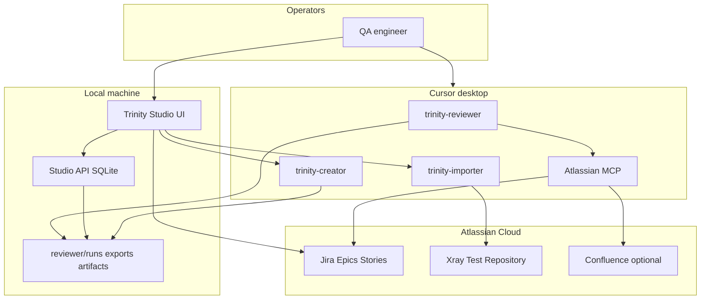

# Trinity — architecture

**Last reviewed:** 2026-10-13  
**Audience:** Operators, QA leads, and engineers onboarding to Trinity.  
**Runbook:** [`FIRST-RUN.md`](FIRST-RUN.md) · **Reference:** [`MANUAL.md`](MANUAL.md)

---

## What Trinity is

Trinity is an **AI-assisted QA pipeline** for Jira-backed products. Four cooperating pieces:

| Piece | Runs in | Purpose |
|-------|---------|---------|
| **Reviewer** | Cursor (`trinity-reviewer`) | Requirement quality: findings, questions, readiness, HTML reports |
| **Trinity Studio** | Local browser + API (`:5173` / `:8765`) | Human triage, approvals, metrics, Jira comments, Importer plan/execute |
| **Creator** | Cursor (`trinity-creator`) | 3–5 E2E journey test drafts per Epic from approved review |
| **Importer** | Studio + Cursor (`trinity-importer`) | Approved tests → Xray in Jira |

**Control plane vs agents:** Cursor **gathers and generates**; Studio **approves, exports, posts, and gates writes** in v1. Studio does not run Reviewer MCP gathers.

---

## System context

---

## Operator pipeline (checkout → Xray)

This matches the diagram attached on this Confluence page (`trinity-operator-pipeline.svg` in git: `Trinity/confluence/assets/`).

```mermaid
flowchart LR
  subgraph pre [Preflight]
    CLONE[Clone repo]
    START[Start Studio]
  end
  subgraph rev [Reviewer]
    CFG[Reviewer config]
    P1[Cursor prompt 1]
    RUN[review-payload.json]
  end
  subgraph stu [Studio]
    IMP[Import run]
    TRI[Triage studio_qa]
    APR[Approve export]
    P2[Send to Creator]
    CRE[Creator import]
    XPL[Export Importer]
    P3[Importer plan]
  end
  subgraph xray [Xray]
    EXEC[Create tests]
    KEYS[Persist keys]
  end
  CLONE --> START --> CFG --> P1 --> RUN --> IMP --> TRI --> APR --> P2
  P2 --> CRE --> XPL --> P3 --> EXEC --> KEYS
```

| Stage | Artifact | Contract |
|-------|----------|----------|
| Reviewer | `reviewer/runs/<run>/<EPIC>/review-payload.json` | [`CONTRACTS.md`](CONTRACTS.md) |
| Studio review | `studio/data/exports/.../review-payload.json` + SQLite `studio_qa` | Same payload + overlay |
| Creator | `creator/artifacts/<EPIC>/suite-payload.json` | Creator batch schema |
| Importer | `importer-payload.json` + Xray import report | Mapping JSON per Jira site |

**Invariant:** epic folder name **must equal** Jira epic key (`scope.value`).

---

## Repository layout

| Path | Role |
|------|------|
| `Trinity/reviewer/` | Reviewer skill, schemas, `render_report.py`, portfolio builder |
| `Trinity/creator/` | Creator skill, golden corpora, product configs |
| `Trinity/importer/` | Xray GraphQL scripts, mapping files |
| `Trinity/studio/` | FastAPI + React, SQLite, fixtures (`DEMO-4500`) |
| `Trinity/personas/` | Runtime prompts (editable in Studio) |
| `Trinity/reviewer/config/runs/` | Portfolio run JSON |
| `Trinity/shared/` | HTML report guidelines (Profile A/B) |

---

## Trust and write boundaries

| Action | Default | Production gate |
|--------|---------|-----------------|
| Reviewer gather | Read-only Jira/Confluence | — |
| Reviewer Jira comment | Copy-paste files; optional auto-post per product config | — |
| Studio Jira epic comment | Explicit confirm + issue key | Type `PRODUCTION` on prod host |
| Importer execute | Dry-run plan first | Type `PRODUCTION` + credentials |
| Importer idempotency / redaction | Block execute until ack or fix | Env override for redaction emergency only |

Telemetry: local SQLite `metric_event`; optional BigQuery ([`METRICS.md`](METRICS.md)). Per-run E2E reports: `pipeline_run_report` + Studio **Statistics** tab (`run_report.py`).

---

## Related documentation

| Doc | Use |
|-----|-----|
| [`FIRST-RUN.md`](FIRST-RUN.md) | First-time operator — phases 0–3, three prompts |
| [`MANUAL.md`](MANUAL.md) | Full operator manual |
| [`reviewer/MANUAL.md`](reviewer/MANUAL.md) | Reading Reviewer HTML reports |
| [`PIPELINE.md`](PIPELINE.md) | Short pipeline map |
| [`GUIDE.md`](GUIDE.md) | Credentials, golden, Importer project key |

Source of truth: git repo `marekwyszynskiappfire/docs` (`Trinity/`).
