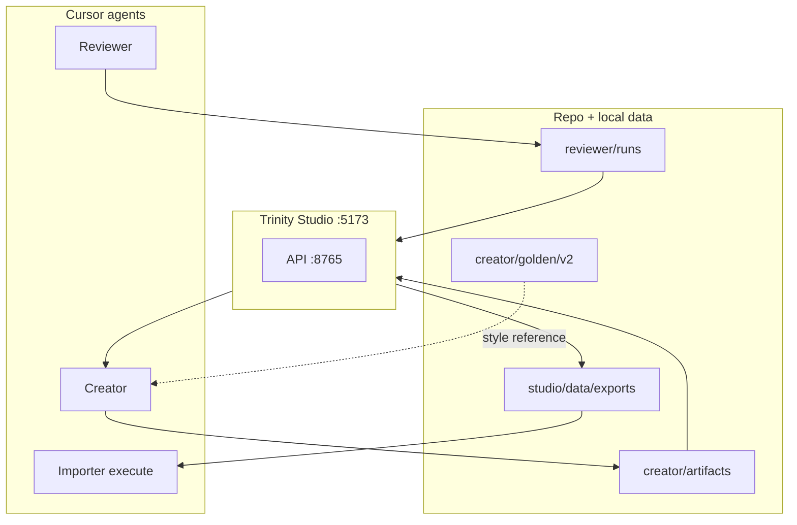

# Trinity — operator guide

Single reference for **what Trinity is**, **how to get running**, **golden test data**, and **Importer configuration** (including the **Jira project selector**).

**Wiki:** [Credentials and Importer](https://appfire.atlassian.net/wiki/spaces/QACoE/pages/3754492109/Trinity+Credentials+and+Importer) · [Start here](https://appfire.atlassian.net/wiki/spaces/QACoE/pages/3754590489/Trinity+Start+here) · [FAQ](FAQ.md)

Related: [OPERATOR-ONBOARDING.md](OPERATOR-ONBOARDING.md) · [FIRST-RUN.md](FIRST-RUN.md) · [CURSOR-MCP-SETUP.md](CURSOR-MCP-SETUP.md) · [PROMPTS-AND-INPUTS.md](PROMPTS-AND-INPUTS.md) · [MANUAL.md](MANUAL.md) · [METRICS.md](METRICS.md)

**Personas:** [`personas/P1-P10.md`](personas/P1-P10.md) (operator matrix) · runtime prompts in [`personas/`](personas/) · [`MANUAL.md`](MANUAL.md) §11 · Reviewer detail in [`reviewer/MANUAL.md`](reviewer/MANUAL.md) §11.

---

## Personas and audiences (P1–P10)

| Layer | Doc |
|-------|-----|
| **P1–P10 matrix** (roles, Trinity touchpoints, lead ownership) | [`personas/P1-P10.md`](personas/P1-P10.md) |
| **Edit Reviewer/Creator tone** | Studio → **Personas** → `Trinity/personas/*.md` |
| **Importer operator lens** | [`personas/importer-xray-operator.md`](personas/importer-xray-operator.md) |
| **Whole-pipeline “who does what”** | [`MANUAL.md`](MANUAL.md) §11 |
| **Reviewer report sections by role** | [`reviewer/MANUAL.md`](reviewer/MANUAL.md) §11 |
**P2 (QA lead)** usually owns golden corpus choice (`creator/config`) and mapping JSON. **P5 (maintainer)** owns personas, checklist, and schema changes.

---

## Getting Started

**Fastest path:** [`QUICKSTART.md`](QUICKSTART.md) — Studio + demo data in ~10 minutes (no Jira).

### Who this is for

QA engineers, test architects, and automation leads running **Epic-scoped** review → test design → Xray import at Appfire (production or sandbox Jira).

### 15-minute first run (no live Jira)

Prefer the committed fixture: `Trinity/studio/fixtures/demo-reviewer-run` or `./Trinity/studio/scripts/seed-demo.sh`.

```bash
git clone https://github.com/marekwyszynskiappfire/docs.git DOCS && cd DOCS
./Trinity/scripts/install-trinity-skills.sh
cd Trinity/studio/web && npm install && cd ../../..
./Trinity/studio/scripts/start.sh
```

Open http://127.0.0.1:5173 → import demo Reviewer folder:

```bash
./Trinity/studio/scripts/seed-demo.sh
# Or manually (folder name = epic Jira key; must match scope.value in payload):
mkdir -p Trinity/reviewer/runs/demo-local-test/DEMO-4500
cp Trinity/reviewer/samples/demo-epic.payload.json \
   Trinity/reviewer/runs/demo-local-test/DEMO-4500/review-payload.json
```

Dashboard → import `Trinity/reviewer/runs/demo-local-test` → **Creator** → import `Trinity/creator/samples/demo-story.suite.json`.

### First production-like path (with Jira)

1. Copy env files — see [§3 Credentials](#3-credentials-setup) below.
2. [PREFLIGHT.md](PREFLIGHT.md) — MCP + `render_report.py` smoke.
3. On the workspace, expand **Reviewer prompt** → **Copy Cursor prompt** → run **trinity-reviewer**. Before a workspace exists, copy that prompt from **More → Reviewer configs**. Open the workspace URL it prints.
4. On the workspace, approve the review → **Copy Creator prompt** → run **trinity-creator**. Studio imports `suite-payload.json` when the file appears.
5. Approve the tests on the workspace and mark the ones for Xray.
6. **Plan Xray import** on the same page: instance, mapping, **project key**, folder → **Preview import plan** → **Write to Xray**. After the preview, **Importer Cursor prompt** copies the trinity-importer prompt. **More → Importer** is the full page.

Hands-on checklist: [TESTING.md](TESTING.md).

### Importer project selector (quick reference)

Studio → **Importer** → section **Jira project for new Tests**:

| What you set | Effect |
|--------------|--------|
| **Jira instance** | Which site (`appfire.atlassian.net` vs sandbox). Production loads Xray keys from `.env.production`. |
| **Mapping file** | Custom fields, labels, link types, **default** `project.key` (often `TC`). Must match instance `jira.site_url`. |
| **Project key** | **Target Jira project for new Test issues.** Overrides mapping default for this run (`project_key_override` in plan API). Autocomplete from Jira when `JIRA_EMAIL` + `JIRA_API_TOKEN` are in `.env`. |
| **Folder path** | Xray Test Repository location (not the Jira project). |
| **Create folder** | Calls Xray `createFolder` using `project.id` from the **mapping file** (not resolved from a different project key). |

**Important:** Changing project key alone does **not** change required custom fields — those come from the mapping JSON. For another project with different fields, add a mapping file ([mappings/README.md](importer/config/mappings/README.md)).

**Why `TC` appears by default:** shipped mappings target the QA Test project used for the golden export (filter 17844), not Creator output. See [§5](#5-importer-why-tc-by-default-choosing-another-project).

**API:** `GET /api/importer/jira-projects?jira_instance_id=&mapping_path=` · plan body field `project_key_override`.

---

## 1. What Trinity does

Trinity is a **QA pipeline** for Epic-scoped work: review requirements, generate journey test suites, human-triage in a local app, then import approved tests into **Xray** on Jira.

| Piece | Role |
|-------|------|
| **Reviewer** (`trinity-reviewer`) | Cursor skill: checklist review → `review-payload.json` + HTML report per Epic |
| **Trinity Studio** | Local workbench (SQLite): import Reviewer runs, edit/approve reviews, import Creator batches, triage tests, export for Importer |
| **Creator** (`trinity-creator`) | Cursor skill: 3–5 **E2E journey** tests from approved `review_ref` (does **not** write to Xray) |
| **Importer** (`trinity-importer`) | Maps approved handoff → Xray `createTest` (+ optional `createFolder`, Jira requirement links) |



**Design rules**

- Agents produce **JSON contracts**; humans approve in Studio before Xray writes.
- **One Creator run per Epic** (CR-EPIC-01).
- **Golden** corpora inform **style/depth** only; they do not choose the Importer Jira project by themselves.

---

## 2. Prerequisites

| Requirement | Notes |
|-------------|--------|
| **Git clone** | This repo (`DOCS`) |
| **Python 3.11+** | Studio API, `render_report.py`, Importer CLI |
| **Node 18+** | Studio React UI (`Trinity/studio/web`) |
| **Cursor** | For Reviewer, Creator, Importer agent runs |
| **Atlassian MCP** (recommended) | Jira/Confluence gather for Reviewer — [DUAL-ATLASSIAN-MCP](reviewer/config/DUAL-ATLASSIAN-MCP.md) |
| **Jira API token** | [Atlassian API tokens](https://id.atlassian.com/manage-profile/security/api-tokens) → `Trinity/studio/.env` |
| **Xray API keys** (Importer execute) | Per Jira site: Xray → Settings → API Keys. Production: `Trinity/studio/.env.production` (gitignored). Sandbox: `.env` when licensed |

Optional: corporate TLS intercept → set `XRAY_INSECURE_SSL=1` in the relevant env file.

---

## 3. Credentials setup

| File | Purpose |
|------|---------|
| `Trinity/studio/.env` | `JIRA_EMAIL`, `JIRA_API_TOKEN`, `JIRA_BASE_URL` (REST + project list), sandbox `XRAY_*` |
| `Trinity/studio/.env.production` | Production `XRAY_*` (and optional prod `JIRA_BASE_URL`) |

Copy from `.env.example` and `.env.production.example`. Never commit real `.env` files.

The **project selector** needs `JIRA_*` in `.env` to populate the datalist; Xray execute needs `XRAY_*` for the chosen instance.

**Xray import policy:** create/update tests in **production** Jira/Xray only. Use sandbox for Jira read and Importer **plan** dry-runs. See [FAQ.md](FAQ.md) and [ADR 0002](../docs/adr/0002-trinity-importer-telemetry-decisions.md).

**Telemetry (optional):** local metrics always on in Studio; BigQuery when `TRINITY_TELEMETRY_URL` is set — [METRICS.md](METRICS.md).

---

## 4. Fresh checkout — exact steps

From repository root:

```bash
# 1. Cursor skills
./Trinity/scripts/install-trinity-skills.sh

# 2. Studio Python + Node deps (first run of start.sh also syncs .venv)
cd Trinity/studio/web && npm install && cd ../../..

# 3. Local secrets (never commit)
cp Trinity/studio/.env.example Trinity/studio/.env
# Edit: JIRA_EMAIL, JIRA_API_TOKEN, JIRA_BASE_URL (sandbox or prod for REST)
cp Trinity/studio/.env.production.example Trinity/studio/.env.production
# Edit: production XRAY_CLIENT_ID, XRAY_CLIENT_SECRET (and prod JIRA_BASE_URL if needed)

# 4. Start Studio (API + Vite)
./Trinity/studio/scripts/start.sh
```

| URL | Purpose |
|-----|---------|
| http://127.0.0.1:5173 | Studio UI |
| http://127.0.0.1:8765/api/health | API health (`features` includes `importer_plan`) |

If ports are busy:

```bash
./Trinity/studio/scripts/stop.sh
STUDIO_FORCE=1 ./Trinity/studio/scripts/start.sh
```

**Smoke (offline Reviewer render)**

```bash
python3 Trinity/reviewer/scripts/render_report.py \
  Trinity/reviewer/samples/demo-epic.payload.json
```

**Smoke (Studio import demo)**

```bash
./Trinity/studio/scripts/seed-demo.sh
```

Or import path `Trinity/studio/fixtures/demo-reviewer-run` on the Dashboard.

Full checklist: [TESTING.md](TESTING.md).

---

## 5. End-to-end operator flow

### 5.1 Reviewer

1. On the workspace, expand **Portfolio** to change scope, persona, and pass type, then expand **Reviewer prompt** → **Copy Cursor prompt**. Create the first portfolio under **More → Reviewer configs** when no workspace exists yet.
2. Run **trinity-reviewer** in Cursor.
3. Outputs: `Trinity/reviewer/runs/{portfolio_run_id}/{EPIC}/review-payload.json`.

### 5.2 Studio — review

1. Open the workspace URL the Reviewer prints. If it did not, expand **Import a review folder** on the workspace (or the workspace list) and open the imported run.
2. Read the verdict. **Next step → Approve** when it is right. **Next step → Copy Creator prompt**.
3. When several Epics are approved, **Prepare Creator prompts** then **Copy Creator prompts**.
4. Open the Epic and expand **Findings and Jira comment** to triage findings and draft the Jira comment. Save the draft before previewing the comment. The same panel is on the Epic’s own page if you want it full screen.

### 5.3 Creator

1. Set **Coverage depth** on the workspace. The copied Creator prompt carries that profile. Then run **trinity-creator** with `review_ref`, the Epic key, and `suite_mode: release_slice_e2e`.
2. Output: e.g. `Trinity/creator/artifacts/{EPIC}/suite-payload.json`. The workspace imports it.
3. Approve or reject each test. Tick **Send to Xray**, or **Approve selected** for the tests you ticked. On the Epic, expand **Import a suite file** when the suite was written to a different path.

### 5.4 Importer

On the workspace, **Plan Xray import** uses the same fields. **Preview plans for N Epics** is a dry-run only. **Write to Xray** stays one Epic at a time. After a preview, **Importer Cursor prompt** copies the trinity-importer prompt. The full page:

1. **More → Importer** (or **Open in Importer** from a Creator run).
2. **Jira instance** — production vs sandbox.
3. **Mapping file** — field IDs, labels, link types; default project key (often `TC`).
4. **Project key** — where Jira **Test** issues are created (see [Getting Started — project selector](#importer-project-selector-quick-reference) and §6).
5. **Test Repository folder** (+ **Create folder** if needed; requires `project.id` in mapping).
6. **Preview import plan** → **Copy Cursor prompt** → run **trinity-importer** execute (or CLI in prompt).

CLI reference: [importer/README.md](importer/README.md).

---

## 6. Importer: why **TC** by default? Choosing another project

### 6.1 Why shipped configs say `TC`

The default mapping files (`Trinity/importer/config/mappings/appfire-production.json` and `appfire-sandbox.json`) set:

```json
"project": { "key": "TC", "id": "…" }
```

because:

1. **Appfire QA** stores manual tests in the **TC** Jira project on `appfire.atlassian.net`.
2. The committed **golden corpus** ([`creator/golden/v2/filter-17844-bigpicture-manual`](creator/golden/v2/README.md)) was exported from Xray tests that live under **TC** (Jira filter 17844).

Golden is used by **Creator** for step depth and naming style (`golden_root` in product config). It does **not** automatically set the Importer target project — that is always an **operator choice** via mapping + project key.

### 6.2 How to import to a different project

**Option A — Studio (quick)**  
Importer → **Project key**: pick from the Jira project list (requires `JIRA_*` in `.env`) or type a key (e.g. `BPQA`). This sets `project_key_override` on the import plan and in the Cursor handoff.

**Option B — Mapping file (repeatable)**  
Copy a mapping JSON per target project:

```bash
cp Trinity/importer/config/mappings/appfire-production.json \
   Trinity/importer/config/mappings/appfire-production-MYPROJ.json
```

Edit:

- `project.key` — Jira project key  
- `project.id` — numeric id (Jira → Project settings → URL), required for **create folder**  
- `defaults.jira_required_fields` — project-specific custom field IDs (discover via Jira create-meta or an existing Test in that project)  
- `defaults.folder_path` — optional default folder in Xray Test Repository  

Document new files in [importer/config/mappings/README.md](importer/config/mappings/README.md).

**Option C — CLI**

```bash
python3 Trinity/importer/scripts/xray_graphql_import.py \
  --config Trinity/importer/config/mappings/appfire-production.json \
  --project MYPROJ \
  --batch …/importer-payload.json \
  --draft-id TC-001 \
  --folder "/My folder" \
  --execute
```

### 6.3 Studio project selector (detailed)

1. Open **Importer** after exporting `importer-payload.json`.
2. Select **Instance** — filters mapping dropdown to matching `jira.site_url`.
3. Select **Mapping file** — sets default folder and default project key; loads field mapping for `createTest`.
4. **Project key** field:
   - Pre-filled from mapping when you change instance/mapping.
   - Type or pick from datalist (populated via `GET /api/importer/jira-projects` when Jira REST credentials work).
   - Sent as `project_key_override` on **Preview import plan** and in the Cursor handoff.
5. If list is empty, check `.env` Jira token and that `JIRA_BASE_URL` matches the instance (or rely on mapping site URL for the API call).
6. **Create folder if missing** — uses `project.id` from the **mapping file**. If you override project key to a project whose id differs from mapping, update the mapping or `createFolder` may target the wrong project.

### 6.4 Instance vs mapping vs project

| Control | Meaning |
|---------|---------|
| **Jira instance** | Which Atlassian site (`appfire.atlassian.net` vs sandbox) |
| **Mapping file** | Xray/Jira field mapping + default project + credentials profile hint |
| **Project key** | Jira project for **new Test issues** (overrides mapping default) |

Use a mapping whose `jira.site_url` matches the selected instance. Studio filters mapping dropdown by site.

---

## 7. Golden test cases — how to obtain them

Golden corpora are **Xray exports** used as Creator **style/depth** references (CR-GOLDEN-01), not as Importer input.

### 7.1 Use what is already in the repo

- **BigPicture v2:** `Trinity/creator/golden/v2/filter-17844-bigpicture-manual/` (245 tests, filter 17844) → `bigpicture.json`
- **Neutral v2 (non-TC products):** `Trinity/creator/golden/v2/neutral-manual-journeys/` (5 journey references) → `default.json`, `requirements.json`
- **Registry:** `Trinity/creator/golden/registry.json` lists corpora and product lines; Studio **Creator** page shows the matrix.

Creator samples golden tests via `Trinity/creator/scripts/sample_golden_references.py` (similarity-first, 5–10 tests).

### 7.2 Export a new golden corpus from Xray (production)

Prerequisites: valid **Xray API keys** for the site (`XRAY_CLIENT_ID` / `XRAY_CLIENT_SECRET`), often `XRAY_INSECURE_SSL=1` on corporate Macs.

1. **Collect issue ids** for a Jira filter or JQL (tests in target project):

   ```bash
   # Paginate Jira search → issues.json (see creator/scripts/merge_jira_search_pages.py)
   ```

2. **Run GraphQL export:**

   ```bash
   export XRAY_CLIENT_ID=… XRAY_CLIENT_SECRET=…
   export XRAY_INSECURE_SSL=1

   python3 Trinity/creator/scripts/xray_graphql_export.py \
     --issues-json path/to/issues.json \
     --out-dir Trinity/creator/golden/v2/my-filter-export \
     --filter-id 17844 --filter-name "My filter name" \
     --workers 6 --batch-size 8 --resume
   ```

3. Commit `extraction.json`, `rag/`, `manifest.json` (not `raw-batches/` — gitignored).

Details: [creator/golden/v2/README.md](creator/golden/v2/README.md).

### 7.3 Golden vs Importer

| | Golden export | Importer |
|---|----------------|----------|
| **Direction** | Xray → repo | repo → Xray |
| **Tool** | `xray_graphql_export.py` | `xray_graphql_import.py` |
| **Typical project** | Often **TC** (QA tests) | **Your choice** per import |
| **Consumed by** | Creator skill | Studio handoff + Importer skill |

---

## 8. Troubleshooting

| Symptom | Action |
|---------|--------|
| Importer API 404 | Restart Studio; health must list `importer_plan` |
| Sandbox Xray 403 Invalid license | Sandbox-specific Xray keys + licensed Xray on sandbox site |
| Plan 0/N valid tests | Usually missing `coverage_catalog_id` — re-export handoff or upgrade Studio (enrichment from `linked_ac_ids`) |
| createTest field errors | Extend mapping `jira_required_fields` for target project |
| Wrong Jira site | Match instance + mapping `jira.site_url`; check `JIRA_BASE_URL` |
| Golden not used in Creator | Confirm `golden_root` in product config; run logs `golden_sampling` in batch JSON |

More: [TESTING.md §5](TESTING.md#5-troubleshooting).

---

## 9. Documentation map

| Document | Audience |
|----------|----------|
| **GUIDE.md** (this file) | New operators, architecture + golden + Importer project |
| [TESTING.md](TESTING.md) | Step-by-step validation |
| [MANUAL.md](MANUAL.md) | Reviewer interview + Studio; **§11 personas** |
| [personas/P1-P10.md](personas/P1-P10.md) | P1–P10 matrix + lead responsibilities |
| [PIPELINE.md](PIPELINE.md) | Short pipeline diagram |
| [CONTRACTS.md](CONTRACTS.md) | JSON schemas index |
| [importer/reference.md](importer/reference.md) | Importer API + GraphQL |
| [creator/SKILL.md](creator/SKILL.md) | Creator rules (golden, steps, Epic scope) |
| [FAQ.md](FAQ.md) | Common engineering questions |
| [METRICS.md](METRICS.md) | Telemetry, rejection reasons, BigQuery (optional) |
